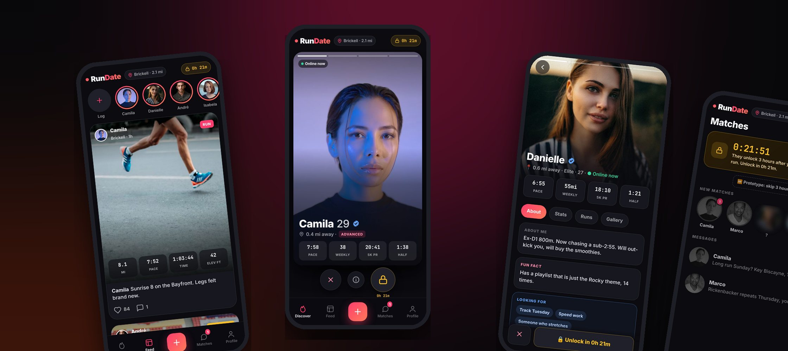

# RunDate

**Matches unlock three hours after you log a run.**

RunDate is a dating app for runners in Brickell, Miami. Dating apps reward being on your phone; training apps reward being outside. RunDate puts swipe mechanics on top of a real activity log, with a lock that makes the run the price of admission.

**Live case study:** https://www.wendelfreitas.com/cases/rundate-miami
**Live app (open on your phone):** https://www.wendelfreitas.com/rundate/app/

| | Path |
|---|---|
| Interactive iOS prototype (EN/ES/PT) | [`app/index.html`](app/index.html) |
| Case-study page (EN/ES/PT, mobile-first) | [`site/case.html`](site/case.html), generated by [`scripts/build_site.py`](scripts/build_site.py) |
| Screenshots | [`docs/screens`](docs/screens) |

## The mechanic: a three-hour match lock
- The like button shows a padlock and stays disabled until three hours after your last logged run.
- Swiping right before unlock raises a warning banner instead of producing a match.
- The Matches tab dims every contact and shows a live countdown.
- A profile's CTA reads "Unlock in Xh Xm" instead of Like.
- Log Activity states the rule before you save, and the confirmation repeats it.

## What works in the prototype
- **Discover:** a swipe deck with real drag physics, rotation, PACE and PASS stamps, tap zones to cycle photos, and verified and online badges. Pace, weekly miles and PRs sit on the photo.
- **Feed:** a Stories row with an auto-advancing viewer. Run, Story and Milestone posts carry a distance, pace, time and elevation bar. You can like (or double-tap) and comment.
- **Matches:** new-match bubbles, message threads and a live lock card. Chat has quick replies and contextual auto-replies.
- **Profile:**
  - a hero photo carousel
  - About: bio, fun fact, Looking For and a quick-info grid
  - Stats: 5K, half and full PRs, physical stats and an 8-week load chart
  - Runs
  - Gallery: a masonry grid with a lightbox and thumbnail strip
  - Settings: geofence radius slider, privacy toggles and language
- **Log Activity:** type, distance, time with live pace, route, photo and caption. Saving restarts the clock and posts to the feed.
- **It's a match:** shown when the other runner already liked you.
- A "skip 3 hours" control lets you test the lock without waiting.

On a phone the app runs full screen. On desktop it sits in a phone frame. URL options: `?embed`, `?lang=es|pt`, `?screen=discover|feed|matches|profile|log|lock|unlock|card|chat|stats|gallery|story`. A parent page can also drive it with `postMessage({rd:'go',v:'log'})` and `postMessage({rd:'lang',v:'pt'})`.

## Tech
Each file is plain HTML, CSS and JS with no framework or build step. Photos come from [Unsplash](https://unsplash.com), and screenshots were rendered with headless Chrome.

## Deploy notes (wendelfreitas.com on GoDaddy)
- `app/index.html` goes to `public_html/rundate/app/index.html`.
- `site/case.html` goes to `public_html/rundate/case.html`. It's served at `/cases/rundate-miami` by `deploy/cases/.htaccess`; every other `/cases/*` route falls back to the site app.
- `/rundate/` redirects to `/cases/rundate-miami`.

Built by [Wendel Freitas](https://www.wendelfreitas.com) with Claude.
